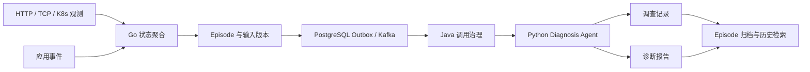
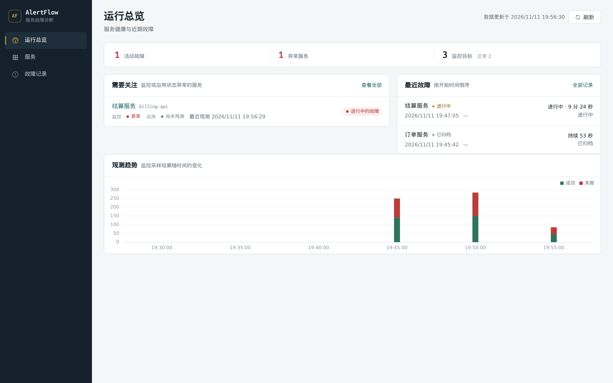
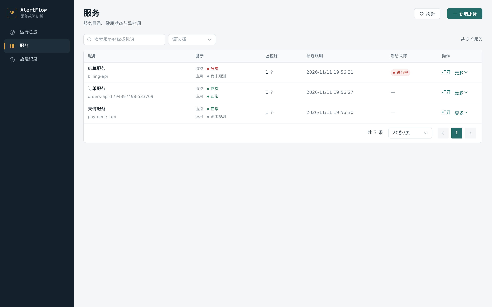
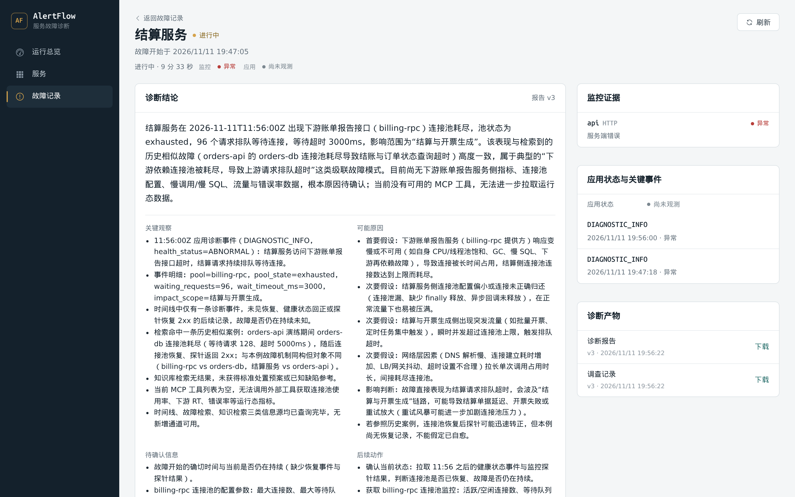

# AlertFlow

**面向服务故障的监控、调查与可追溯诊断系统。**

AlertFlow 将 HTTP / TCP 探测、Kubernetes 工作负载观察、应用侧事件和 Agent 诊断组织到同一条故障处理链路中。每次故障以 Episode 管理，保留调查过程 `investigation.md` 与结构化诊断报告 `diagnosis_report`。

## 故障处理链路



## 架构边界

| 部分 | 职责 |
|---|---|
| **Go 系统侧** | 服务与监控目标、采样、状态聚合、Episode 生命周期、输入版本、任务编排 |
| **Java 集成侧** | Go / Python gRPC 桥接、远端调用治理、A2A 调用、MCP Gateway |
| **Python 认知侧** | 基于故障时间轴和历史经验执行调查，生成并归档双诊断产物 |
| **Web 控制台** | 服务运行状态、监控源管理、故障过程与诊断结果展示 |

PostgreSQL 保存业务事实；Redis 仅用于查询缓存；Kafka 传递任务就绪事件；LangGraph Checkpoint 只用于工作流恢复。Knowledge Agent 是独立可选服务，不是主诊断 Agent 的一部分。

## 核心能力

- **多源观测**：HTTP、TCP，以及单 namespace 下的 Kubernetes Deployment / StatefulSet。
- **故障建模**：失败与恢复阈值、监控与应用双来源状态、Episode 和输入版本。
- **可靠任务交付**：PostgreSQL Outbox、Kafka 与 Agent 侧幂等 receipt。
- **Agent 调查**：查询故障时间轴、历史故障与可选知识库证据。
- **双产物留存**：调查记录与诊断报告按 Episode 保存，并形成历史故障索引。
- **运维控制台**：总览、服务与监控目标管理、故障列表、时间轴、诊断结果。

## 界面预览

| 运行总览 | 服务目录 |
|---|---|
|  |  |

| 故障详情与诊断结论 | 调查记录 |
|---|---|
|  |  |

截图来自本地 Compose 演练：3 个演示服务、1 个进行中的故障 Episode，诊断由真实模型生成中文报告。

## 本地启动

需要 Docker Engine 与 Docker Compose。仓库根目录执行：

```bash
cp deploy/.env.example deploy/.env
# 需要真实模型诊断时，填写 deploy/.env 中的 ALERTFLOW_LLM_API_KEY

docker compose -f deploy/docker-compose.yml up -d --build
```

控制台：<http://127.0.0.1:13000>  
Go API：<http://127.0.0.1:18080/api/v1>

不配置模型 Key 时，采样、Episode 和任务链路仍可运行，但 Agent 使用 ScriptedModel 产生脚本化结果；这不代表真实模型诊断。Knowledge Agent 默认不启动，需要时使用 `--profile knowledge`，并配置对应 A2A Token。

停止服务并保留数据库：

```bash
docker compose -f deploy/docker-compose.yml down
```

`down -v` 会删除数据库及知识库命名卷，请勿用于需要保留数据的环境。

## 故障演练

`deploy/e2e.sh` 用本地 HTTP 故障辅助服务制造 500 响应，通过真实监控采样创建 Episode，再提交应用侧诊断事件，等待 Agent 处理、恢复并归档。

演练以 `orders-api` 为前缀创建服务（`service_key` 形如 `orders-api-<时间戳>-<pid>`），监控目标是容器内地址 `http://fault:8081/health`。故障辅助服务只在宿主机回环地址暴露 `127.0.0.1:${FAULT_PORT:-18081}`，不会绑定外网；如果修改了 `FAULT_PORT`，请同步替换下方命令中的端口。

```bash
# 从仓库根执行
deploy/e2e.sh
```

需要真实模型结果时，先在 `deploy/.env` 配置 `ALERTFLOW_LLM_API_KEY`、`ALERTFLOW_LLM_BASE_URL`、`ALERTFLOW_LLM_MODEL`。未配置 Key 时 Agent 使用 ScriptedModel，只验证采样、Episode、任务与双产物链路，产物是脚本化结果，不代表真实模型诊断质量。需要 Knowledge Agent 时设置 `COMPOSE_PROFILES=knowledge` 并配置 A2A Token；未启用时脚本跳过 FD 与 Knowledge 相关校验。

演练会写入测试数据，并暂时停用演练前已启用的监控目标（脚本退出时恢复）。建议用独立的 `COMPOSE_PROJECT_NAME` 启动，结束后执行 `docker compose down -v` 销毁演练数据，不要对生产数据库运行。也可以手工操作故障辅助服务：

```bash
curl -s -o /dev/null -w '%{http_code}\n' http://127.0.0.1:18081/health  # 故障时 500，恢复后 200
curl -s -X POST http://127.0.0.1:18081/break                            # 制造故障
curl -s -X POST http://127.0.0.1:18081/recover                          # 恢复
```

完整步骤和验证点见 [`docs/engineering/runtime-and-http.md`](docs/engineering/runtime-and-http.md)。

## Kubernetes 部署

Kubernetes 仅部署 Go、Java、Python 与前端应用。PostgreSQL、Kafka、Redis、Nacos 使用集群外部已有服务。应用为单副本；K8s 观察默认关闭，启用后 Go 使用 client-go 只读 Get Deployment / StatefulSet。

完整镜像构建、Secret、RBAC、配置和部署命令见 [`deploy/k8s/README.md`](deploy/k8s/README.md)。Kubernetes 清单尚未在真实集群完成运行验证。

## 目录

```text
backend/       Go 系统侧、监控与 API
integration/   Java 集成侧
agent/         Python 主诊断 Agent
frontend/      Vue 运维控制台
proto/         gRPC 协议
deploy/        Compose、Dockerfile、演练脚本、Kubernetes 清单
docs/          架构与工程说明
```

## 当前范围与限制

- Kubernetes 仅支持单 namespace 的 Deployment / StatefulSet 只读观察；不包含 Pod / Node 监控、Informer / Watch、多集群或集群级权限。
- Go、Java、Python 均按单副本部署；不包含 HPA 或高可用保证。
- 控制台目前没有登录与权限系统，只适合本地或可信内网；不要直接暴露到公网。
- 集群内 gRPC 当前未启用 TLS，应限制在可信网络边界内。

## 相关文档

- [Kubernetes 应用部署](deploy/k8s/README.md)
- [运行时、HTTP 与 gRPC 边界](docs/engineering/runtime-and-http.md)
- [集成侧设计](docs/design/integration-side.md)
- [Knowledge Agent 集成](docs/design/knowledge-agent-integration.md)
