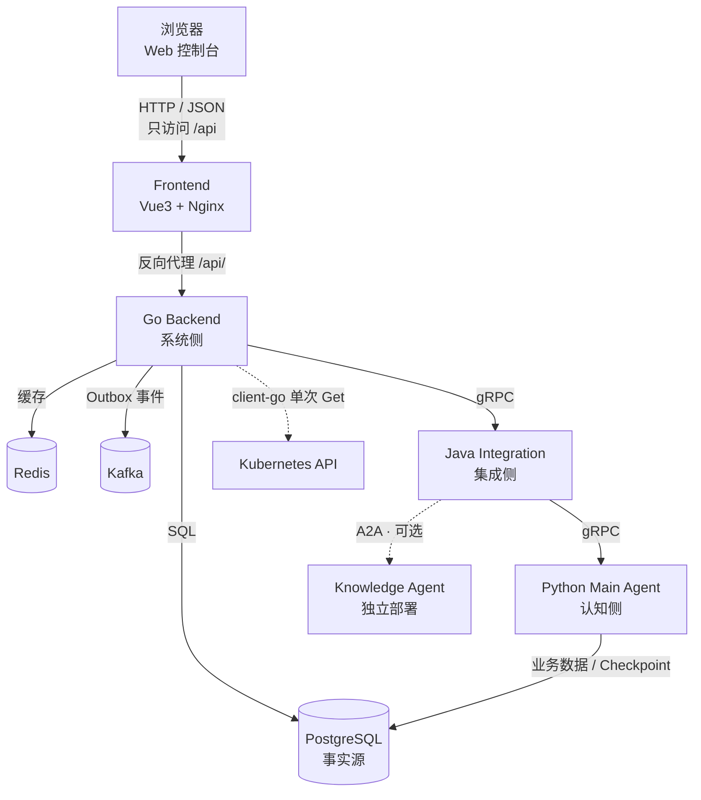

# AlertFlow｜服务监控与可追溯故障诊断系统

AlertFlow 面向多服务运行环境，把「发现异常 → 管理故障生命周期 → 调查诊断 → 沉淀可检索的诊断产物」串成一条可追溯的链路。系统将传统监控采样与 Agent 调查结合：Go 系统侧负责监控采样、故障状态与任务编排，Java 集成侧负责调用治理与转发，Python 认知侧基于故障时间轴和历史经验开展调查，最终保留调查记录与诊断报告两类产物。

## 1. 项目定位

- 面向需要同时管理多个服务、并希望把「一次故障如何发生、如何被调查、结论是什么」留档的环境。
- 监控只负责发现和归一化异常；故障本身由 Episode、来源状态和输入版本建模，避免把「一次探测失败」直接等同于「一次故障」。
- 诊断由 Agent 异步执行，可反复重试；监控采样和故障生命周期不依赖模型可用性。
- 产物可回查：故障时间轴、调查文档 `investigation.md` 与诊断报告 `diagnosis_report` 都按 Episode 保存。

## 2. 核心能力

- **多源监控**：HTTP、TCP，以及 Kubernetes `Deployment` / `StatefulSet` 工作负载状态观察。
- **故障生命周期管理**：按失败/恢复阈值维护目标状态，将来源状态聚合为服务健康状态，并在异常时创建 Episode；Episode 有 ACTIVE / RESOLVED / ARCHIVED 三态。
- **诊断输入版本**：监控投影与应用上报变化会计算输入哈希；只有有效输入变化才产生新版本，避免重复诊断。
- **异步任务处理**：PostgreSQL Outbox + Kafka 传递诊断任务，Python 侧按 `task_id` / Episode 幂等执行。
- **Agent 调查诊断**：主诊断 Agent 查询 Episode 时间轴、检索历史故障，可选通过 Knowledge Agent 检索证据，并持续维护调查文档与诊断报告。
- **双产物沉淀**：`investigation.md` 与 `diagnosis_report` 按 Episode 版本化保存，归档 Agent 提取 `FaultSearchIndex` 供历史检索。
- **Web 运维控制台**：总览、服务与监控目标管理、Episode 列表与详情、时间轴和双产物展示。

## 3. 三侧架构与职责



### 三侧职责

| 模块 | 技术 | 主要职责 |
|---|---|---|
| 系统侧 | Go / Gin / PostgreSQL / Redis / Kafka | 服务与监控目标管理、探测采样、来源状态与 Episode 生命周期、输入哈希与版本、Outbox、任务调度、gRPC 系统接口 |
| 集成侧 | Java / Spring Boot / WebFlux / gRPC | Go 与 Python 之间的 gRPC 桥接、调用幂等与租约、A2A 调用 Knowledge Agent、MCP Gateway |
| 认知侧 | Python / FastAPI / LangGraph | 主诊断 Agent、调查文档与诊断报告、归档与 FD 索引、历史故障检索 |
| Web 控制台 | Vue 3 / TypeScript / Vite / Element Plus | 服务与目标管理、故障查看、时间轴与产物展示 |
| 基础设施 | PostgreSQL / Kafka / Redis / Nacos | 业务事实源、事件通道、旁路缓存、Agent Card 发现 |

职责边界：

- 浏览器只访问前端，前端只调用 Go 的 `/api/v1` 接口；Java 与 Python 的 HTTP/gRPC 端口不对浏览器暴露。
- Go 不直接调用 Python；Python 的系统调用也先到 Java，再由 Java 转发到 Go。
- PostgreSQL 是服务、目标、Episode、时间轴、产物和任务的事实源；Redis 只做查询缓存；LangGraph Checkpoint 只用于工作流恢复，不是业务产物的权威存储。
- Kubernetes 观察由 Go 系统侧完成，只使用 client-go 对 `Deployment` / `StatefulSet` 做单次 `Get`，不使用 Informer / Watch。

## 4. 技术栈与目录结构

### 技术栈

- **Backend**：Go、Gin、PostgreSQL（goose 迁移）、Redis、Kafka、gRPC、client-go
- **Integration**：Java、Spring Boot、Spring WebFlux、gRPC、A2A、MCP、Nacos、Flyway
- **Agent**：Python、FastAPI、LangGraph、PostgreSQL Checkpoint、pgvector
- **Frontend**：Vue 3、TypeScript、Vite、Vue Router、Pinia、Element Plus、Axios、ECharts
- **Deployment**：Docker、Docker Compose、Kubernetes（应用组件部署与工作负载观察）

### 目录结构

```text
.
├── backend/                     # Go 系统侧
│   ├── cmd/alertflow/           # 进程入口
│   └── internal/
│       ├── api/                 # HTTP 路由与响应
│       ├── system/              # 服务、目标、Episode、哈希与任务
│       ├── monitor/             # HTTP / TCP / Kubernetes 探测
│       ├── gateway/             # Outbox、Kafka、gRPC 网关
│       ├── cache/               # Redis 旁路缓存
│       └── db/migrations/       # goose 迁移
├── integration/                 # Java 集成侧
│   └── src/main/java/           # gRPC 桥接、A2A、MCP
├── agent/                       # Python 认知侧
│   └── src/alertflow_agent/     # HTTP、gRPC、LangGraph、产物
├── proto/                       # Protobuf 源文件
├── gen/                         # 生成的 Go gRPC 代码
├── frontend/                    # Vue 3 Web 控制台
│   └── src/                     # api / router / stores / views
├── deploy/
│   ├── docker-compose.yml       # 本地开发与演示环境
│   ├── .env.example             # Compose 环境变量模板
│   ├── Dockerfile.backend       # Go 镜像
│   ├── Dockerfile.agent         # Python Agent 镜像
│   ├── e2e.sh                   # 闭环演练脚本
│   └── k8s/                     # Kubernetes 应用清单与专项说明
├── docs/                        # 架构与工程文档
└── README.md
```

> 本文件中的端口、路径、环境变量与 API 名称按当前仓库实际文件核对。历史设计文档位于 `docs/`，其中 `docs/design/v1.md` 是第一版设计基线，`docs/engineering/runtime-and-http.md` 记录运行时与 HTTP/gRPC 边界。

## 5. 功能边界

### 当前实现

| 能力 | 当前范围 |
|---|---|
| 常规监控 | HTTP、TCP |
| Kubernetes 监控 | `Deployment`、`StatefulSet`；namespace 由 Go 环境变量统一指定 |
| Kubernetes 观察方式 | client-go 单次 `Get`；不使用 Informer / Watch；只读权限 |
| 故障建模 | 目标阈值判定、来源状态聚合、Episode、输入哈希与版本 |
| 诊断执行 | Kafka Outbox 事件、Java 桥接、Python 主诊断 Agent、可选 Knowledge Agent |
| 产物 | `investigation.md`、`diagnosis_report`、FD 索引 |
| 控制台 | 总览、服务、监控目标、Episode 列表与详情、时间轴、产物 |
| 部署 | Docker Compose（本地/演示）、Kubernetes（应用组件，中间件外部） |

### 非目标

本期明确不包含：Pod / Node / Namespace 级监控、Kubernetes Informer / Watch、多集群或多 namespace 授权、Helm / Operator / CRD、ClusterRole、诊断服务多副本与 HPA、PostgreSQL / Kafka / Redis / Nacos 的 Kubernetes 集群化部署、控制台登录与 RBAC、多租户、WebSocket 实时推送、Agent 流程编辑器、移动端。具体限制见第 13 节。

## 6. Docker Compose 快速启动

Compose 是本地开发和演示的默认方式。默认关闭 Kubernetes 监控，普通开发者不需要 Kubernetes 集群、kubeconfig 或 ServiceAccount。

### 6.1 环境要求

- Docker Engine 与 Docker Compose（使用 `docker compose` 插件命令；交付时用 Compose v5.2.0 校验过配置解析）
- 可选：OpenAI 兼容的模型 API 凭据（需要真实模型诊断时才填写；不填写时 Agent 使用 ScriptedModel，见 8.1）

### 6.2 准备环境变量

在仓库根目录执行：

```bash
cp deploy/.env.example deploy/.env
```

按 `deploy/.env.example` 中的注释填写。最少可以不改任何值直接启动；需要真实模型诊断时填 `ALERTFLOW_LLM_API_KEY`，需要启用独立 Knowledge Agent 时设置 `ALERTFLOW_KNOWLEDGE_ENABLED=true` 与 `KNOWLEDGE_A2A_TOKEN`。

> `docker compose` 会自动读取 Compose 文件所在目录的 `deploy/.env`；也可以显式使用 `--env-file deploy/.env`。`deploy/.env` 可能包含数据库密码与模型 Key：提交前确认它没有被 `git add`（必要时把 `deploy/.env` 加入 `.gitignore`，或把 `--env-file` 指向仓库外的文件）。

### 6.3 构建并启动

在仓库根目录执行：

```bash
docker compose -f deploy/docker-compose.yml up -d --build
```

首次构建会拉取 PostgreSQL、Kafka、Redis、Nacos 等镜像并构建 Go / Java / Python / Frontend 镜像，耗时取决于网络和机器。若要启用独立 Knowledge Agent（独立镜像、独立数据卷）：

```bash
docker compose -f deploy/docker-compose.yml --profile knowledge up -d --build
```

### 6.4 等待健康检查并查看状态

```bash
docker compose -f deploy/docker-compose.yml ps
docker compose -f deploy/docker-compose.yml logs -f alertflow
```

等待 `postgres` 与 `alertflow` 的健康检查通过（Go 镜像内置 `HEALTHCHECK`，探测 `/healthz`）；`frontend` 依赖 Go 就绪后启动。首次启动时 Go 会执行数据库迁移，`db-init` 会创建 Java / Knowledge 侧所需的数据库角色。

### 6.5 Compose 服务表

| Compose 服务 | 容器内端口 | 宿主机端口 | 作用 |
|---|---|---|---|
| `frontend` | 80（Nginx） | `13000` | Web 控制台；`/api/` 反向代理到 `alertflow:8080` |
| `alertflow` | 8080 HTTP / 9090 gRPC | `18080` | Go 系统侧 API、监控与任务编排 |
| `integration` | 8081 HTTP / 9091 gRPC | 不发布 | Java 集成侧 |
| `agent` | 8000 HTTP / 9000 gRPC | 不发布 | Python 主诊断 Agent |
| `postgres` | 5432 | 不发布 | 业务事实源（pgvector），数据存 `postgres-data` 卷 |
| `kafka` | 9092 | 不发布 | 诊断任务事件通道 |
| `redis` | 6379 | 不发布 | 查询旁路缓存 |
| `nacos` | 8848 | 不发布 | Agent Card 地址发现 |
| `db-init` | — | — | 一次性创建 `gateway_app` / `knowledge_app` 数据库角色与 `knowledge` 库 |
| `fault` | — | — | 本地演练用的故障目标辅助容器 |
| `knowledge-agent` | 8000 | 不发布 | 可选，仅 `--profile knowledge` 启动 |

### 6.6 常用命令

```bash
# 查看全部日志
docker compose -f deploy/docker-compose.yml logs -f

# 查看某个服务日志
docker compose -f deploy/docker-compose.yml logs -f alertflow
docker compose -f deploy/docker-compose.yml logs -f agent

# 停止并删除容器，保留命名数据卷（postgres-data、knowledge-data）
docker compose -f deploy/docker-compose.yml down
```

如需连同 Knowledge Agent 一起停止，退出时加 `--profile knowledge`。停止与数据保留的注意事项见第 9 节。

## 7. 端口与访问

### 7.1 Compose 访问入口

| 入口 | 地址 | 说明 |
|---|---|---|
| Web 控制台 | <http://127.0.0.1:13000> | 浏览器只访问前端；前端 Nginx 将 `/api/` 代理到 Go |
| Go HTTP API | <http://127.0.0.1:18080> | 健康检查 `GET /healthz`、`GET /readyz`；业务接口前缀 `/api/v1` |
| Go API 示例 | <http://127.0.0.1:18080/api/v1/dashboard/summary> | 总览聚合数据 |

Java Integration（8081/9091）、Python Agent（8000/9000）、PostgreSQL、Kafka、Redis、Nacos 只在 Compose 内部网络可达，不映射到宿主机。

### 7.2 Kubernetes 访问入口

Kubernetes 部署不安装 Ingress Controller，使用端口转发访问前端：

```bash
kubectl -n alertflow port-forward svc/frontend 13000:80
```

浏览器打开 <http://127.0.0.1:13000>；集群内的 Java / Python / gRPC 端口不对外暴露。

## 8. 配置说明

完整变量模板见 `deploy/.env.example`；下面列出影响使用方式的关键配置。

### 8.1 模型配置（Python Agent）

| 变量 | 必填性 | 默认 | 作用 |
|---|---|---|---|
| `ALERTFLOW_LLM_API_KEY` | 选填 | 空 | OpenAI 兼容模型 API Key。为空时 Agent 走 `ScriptedModel`，不调用外部模型 |
| `ALERTFLOW_LLM_BASE_URL` | 选填 | `https://api.openai.com/v1` | 模型接口地址 |
| `ALERTFLOW_LLM_MODEL` | 选填 | `gpt-4o-mini` | 模型名称 |

没有模型密钥时，监控采样、Episode 创建与时间轴仍然正常工作；诊断任务仍会执行，但 `ScriptedModel` 按固定顺序查询时间轴与历史故障，生成**脚本化的固定报告**（其中会明确标注“外部模型未启用”）。这能证明任务链路可用，但不代表真实模型诊断。要得到真实的调查与诊断结论，必须配置模型 Key 并重新触发诊断。

### 8.2 Kubernetes 监控开关（Go Backend）

| 变量 | 必填性 | 默认 | 作用 |
|---|---|---|---|
| `ALERTFLOW_K8S_ENABLED` | 选填 | `false` | 是否启用 Kubernetes 工作负载监控。Compose 默认关闭 |
| `ALERTFLOW_K8S_NAMESPACE` | 选填 | `default` | 被观察工作负载所在 namespace，由 Go 统一配置，不按 target 存储 |

启用时 Go 使用 InClusterConfig 访问 Kubernetes API，只对 `Deployment` / `StatefulSet` 做单次 `Get`。Compose 场景没有集群时不建议开启；Kubernetes 场景的 RBAC 与启用步骤见第 10 节和 `deploy/k8s/README.md`。

### 8.3 其他关键变量

| 变量 | 所在服务 | 必填性 | 默认 | 作用 |
|---|---|---|---|---|
| `ALERTFLOW_DATABASE_URL` | Go / Python | 必填（Compose 固定） | 本地 `127.0.0.1:5432` | PostgreSQL 连接串，两侧共库 |
| `ALERTFLOW_HTTP_ADDR` | Go | 选填 | `:8080` | Go HTTP 监听地址 |
| `ALERTFLOW_GRPC_ADDR` | Go | 选填 | `:9090` | Go gRPC 监听地址 |
| `ALERTFLOW_KAFKA_BROKERS` | Go | 选填 | 空 | Kafka broker 列表；为空时不投递 Outbox 事件 |
| `ALERTFLOW_KAFKA_TOPIC` | Go | 选填 | `alertflow.agent-task-ready.v1` | 诊断任务就绪事件 topic |
| `ALERTFLOW_REDIS_URL` | Go | 选填 | 空 | Redis 地址；为空时不用缓存 |
| `ALERTFLOW_AGENT_GRPC_TARGET` | Go | 选填 | 空 | Go 访问 Java gRPC；为空时产物接口返回 503 `AGENT_UNAVAILABLE` |
| `FRONTEND_PORT` | Compose | 选填 | `13000` | 前端宿主机端口 |
| `INTEGRATION_HTTP_ADDR` / `INTEGRATION_GRPC_ADDR` | Java | 选填 | `:8081` / `:9091` | Java HTTP / gRPC 监听地址 |
| `INTEGRATION_DATABASE_URL` / `INTEGRATION_DATABASE_USER` / `INTEGRATION_DATABASE_PASSWORD` | Java | 必填（非 Compose 环境） | Compose 固定 | Java `gateway` schema 的 JDBC 连接与账号 |
| `NACOS_SERVER_ADDR` / `NACOS_USERNAME` / `NACOS_PASSWORD` | Java | 选填 | 空 | Nacos 地址与鉴权；为空时不向 Nacos 发现 Agent |
| `INTEGRATION_AGENT_CARDS` | Java | 选填 | 空 | 静态 Agent Card，格式 `agent-id=url`，逗号分隔 |
| `KNOWLEDGE_A2A_TOKEN` | Java / Knowledge Agent | 启用 Knowledge 时必填 | 空 | A2A Bearer Token；为空时 Java 拒绝 A2A 调用 |
| `ALERTFLOW_KNOWLEDGE_ENABLED` | Python | 选填 | `false` | 诊断图是否调用 Knowledge Agent |
| `ALERTFLOW_MCP_ENDPOINT` / `ALERTFLOW_MCP_TOKEN` | Python | 选填 | 空（Compose 固定 Token 为 `main-agent-token`） | Java MCP Gateway 地址与 Token |
| `ALERTFLOW_GRPC_TARGET` | Python | 选填 | `127.0.0.1:9090` | Python 访问 Java gRPC（Java 再转发 Go） |
| `AGENT_MAX_CONCURRENT_TASKS` | Python | 选填 | `4` | 并发执行任务数 |
| `AGENT_TASK_QUEUE_CAPACITY` | Python | 选填 | `128` | 任务队列容量 |
| `AGENT_SHUTDOWN_TIMEOUT` | Python | 选填 | `20` | 退出时等待执行中任务的秒数 |
| `KNOWLEDGE_UPLOAD_MAX_BYTES` | Knowledge Agent | 选填 | `33554432` | 单文件上传上限（字节） |
| `KNOWLEDGE_INGEST_MAX_ATTEMPTS` | Knowledge Agent | 选填 | `5` | 摄取最大尝试次数 |

### 8.4 安全提醒

- 数据库密码、模型 API Key、A2A / MCP Token 只通过环境变量、Compose `.env` 或 Kubernetes Secret 提供，不写进代码、镜像或 Git。
- K8s 监控默认关闭；Go 的 Kubernetes 权限只授予 `get` `deployments` / `statefulsets`，不创建 `ClusterRole`。
- 当前 gRPC 通道没有 TLS，仅适用于本地、内网或集群内部通信。

## 9. 数据持久化与停止服务

- **PostgreSQL 是事实源**：服务、监控目标、Episode、时间轴、输入版本、Outbox、任务 receipt、调查文档与诊断报告都保存在 PostgreSQL；LangGraph Checkpoint 只用于工作流恢复，不是调查文档或诊断产物的权威存储。
- **PostgreSQL 数据**：Compose 将数据库目录挂载到命名卷 `postgres-data`（`/var/lib/postgresql/data`），`docker compose down` 不会删除它。
- **Knowledge Agent 数据**：命名卷 `knowledge-data` 挂载到 `/data/knowledge`，仅在使用 `--profile knowledge` 时创建/使用。

安全停止（保留命名卷）：

```bash
docker compose -f deploy/docker-compose.yml down
```

危险操作：

```bash
# 删除 Compose 管理的命名卷（含 postgres-data 与 knowledge-data）
docker compose -f deploy/docker-compose.yml down -v
```

> **不要随意执行 `down -v`。** 该命令会删除卷中的持久化数据，包括数据库文件与知识库文档。需要重置环境时，先确认数据已备份或确定可以丢弃。

## 10. Kubernetes 部署步骤

本节给出最小流程；完整说明（前置条件、Secret 创建、探针、RBAC、排障、限制）见 [`deploy/k8s/README.md`](deploy/k8s/README.md)，本文不复制全部 YAML。

### 10.1 部署边界

- 只部署 AlertFlow 应用组件：Go Backend、Java Integration、Python Main Agent、Frontend。
- PostgreSQL、Kafka、Redis、Nacos 使用集群外部已有环境，通过集群网络可达的地址访问；不能直接照搬 Compose 的 `postgres` / `kafka` / `redis` / `nacos` 服务名，除非外部环境确实提供同名 DNS。
- Knowledge Agent 为可选组件，本期清单不包含其 Deployment；需要时单独部署并配置地址与 Token。

### 10.2 前置条件

- 可用的 Kubernetes 集群与 `kubectl`，当前 context 有权限创建 Namespace 级资源。
- 外部 PostgreSQL、Kafka、Redis、Nacos 已就绪；数据库、账号与网络连通性已确认。
- 四个镜像已构建并推送到集群可拉取的镜像仓库；集群节点能访问模型 API（如启用）。

### 10.3 构建并推送镜像

在仓库根目录执行（镜像地址可按你的 registry 替换，正式部署使用明确 tag，不用 `latest`）：

```bash
# Go Backend
docker build -f deploy/Dockerfile.backend -t ghcr.io/ecakeman/alertflow-backend:v0.1.0 .
docker push ghcr.io/ecakeman/alertflow-backend:v0.1.0

# Java Integration
docker build -f integration/Dockerfile -t ghcr.io/ecakeman/alertflow-integration:v0.1.0 .
docker push ghcr.io/ecakeman/alertflow-integration:v0.1.0

# Python Main Agent（构建上下文是 agent/）
(cd agent && docker build -f ../deploy/Dockerfile.agent -t ghcr.io/ecakeman/alertflow-agent:v0.1.0 .)
docker push ghcr.io/ecakeman/alertflow-agent:v0.1.0

# Frontend（构建上下文是 frontend/）
docker build -f frontend/Dockerfile -t ghcr.io/ecakeman/alertflow-frontend:v0.1.0 frontend
docker push ghcr.io/ecakeman/alertflow-frontend:v0.1.0
```

### 10.4 创建 Namespace、Secret 与中间件配置

```bash
kubectl apply -f deploy/k8s/00-namespace.yaml
```

按 `deploy/k8s/secret.example.yaml` 的字段创建真实 Secret（数据库密码、模型 Key、A2A / MCP Token 等），推荐用 `kubectl create secret` 命令或复制示例到仓库外修改后 apply；示例文件中的占位值不能用于真实环境。同时按 `deploy/k8s/README.md` 修改 `20-configmap.yaml` 中外部中间件地址占位，以及 `40-deployments.yaml` 中的镜像地址。

### 10.5 按顺序部署应用

```bash
kubectl apply -f deploy/k8s/10-rbac.yaml
kubectl apply -f deploy/k8s/20-configmap.yaml
kubectl apply -f deploy/k8s/30-services.yaml
kubectl apply -f deploy/k8s/40-deployments.yaml
```

不要执行 `kubectl apply -f deploy/k8s/`，否则会把 `secret.example.yaml` 示例 Secret 一起创建。

### 10.6 验证与访问

```bash
kubectl -n alertflow get pods
kubectl -n alertflow get deploy,svc
kubectl -n alertflow logs deploy/alertflow --tail=100
kubectl -n alertflow port-forward svc/frontend 13000:80
```

浏览器访问 <http://127.0.0.1:13000>。Go Pod 的探针是 `/healthz`（liveness）与 `/readyz`（readiness，只检查数据库）。

### 10.7 启用 Kubernetes 工作负载监控

Kubernetes 监控默认关闭。RBAC 已提供 Go 专用 ServiceAccount `alertflow-go`，只允许在授权 namespace 内 `get` `deployments` / `statefulsets`。启用步骤：

```bash
# 1. 打开开关并指定被观察 namespace（必须与 RBAC 授权一致）
kubectl -n alertflow patch configmap alertflow-go-config --type merge -p \
  '{"data":{"ALERTFLOW_K8S_ENABLED":"true","ALERTFLOW_K8S_NAMESPACE":"alertflow"}}'

# 2. 重启 Go Backend 使配置生效
kubectl -n alertflow rollout restart deploy/alertflow
```

随后在控制台为服务新增 `KUBERNETES` 目标：`resource_kind` 取 `Deployment` 或 `StatefulSet`，`resource_name` 填工作负载名；namespace 由 Go 环境变量统一决定，不在目标里配置。若目标在别的 namespace，需要把 Role/RoleBinding 复制到目标 namespace 并修改 `ALERTFLOW_K8S_NAMESPACE`。

## 11. 最小使用流程

前置：Compose 已启动，浏览器打开 <http://127.0.0.1:13000>。

1. **新建服务**：在左侧「服务管理」页点击「新增服务」，填写服务标识、服务名称、权威应用（`authority_producer_id`），并至少添加一个监控目标。
   - HTTP 目标：填写探测地址（如仓库自带的 `http://fault:8081/health`）、间隔、超时、失败/恢复阈值。
   - TCP 目标：填写 `host:port` 探测地址与相同阈值。
   - Kubernetes 目标：`target_type=KUBERNETES`，`resource_kind` 选 `Deployment`/`StatefulSet`，`resource_name` 填工作负载名；`address` 留空；间隔/超时未填时使用默认值（10000 / 3000 毫秒）。
2. **查看目标状态**：在服务详情或「监控目标」页查看每个目标的 `NORMAL` / `ABNORMAL` / `UNKNOWN`、连续失败/成功次数与最近检测时间。
3. **触发故障**：停止被监控的 HTTP/TCP 目标，或让目标连续失败达到失败阈值；Go 会在下一个调度周期内把目标/来源状态判为异常并创建 Episode。Compose 自带的 `fault` 辅助容器默认让 `GET /health` 返回 500，可直接作为演示目标；要让它恢复，在容器网络内调用 `POST /recover`：

   ```bash
   docker compose -f deploy/docker-compose.yml exec fault python -c \
     "import urllib.request; urllib.request.urlopen(urllib.request.Request('http://127.0.0.1:8081/recover', method='POST'))"
   ```
4. **查看 Episode**：在「故障 Episode」页按状态、服务、时间筛选；列表分页展示输入版本、处理进度与当前任务状态。
5. **查看详情**：进入 Episode 详情，查看三块时间轴区域（监控投影、应用事件、Agent 产物）、状态变化与当前输入版本。
6. **查看双产物**：诊断执行后，在产物区查看 `investigation.md` 与 `diagnosis_report`；支持 Markdown 安全渲染与原文下载。归档完成后 Episode 进入 `ARCHIVED`，FD 索引可供后续历史检索。
7. **无模型密钥时**：第 1–5 步与 Episode 创建、时间轴、任务链路仍可走通；诊断产物是 ScriptedModel 的脚本化固定结果，不代表真实模型诊断。配置 `ALERTFLOW_LLM_API_KEY` 后重新触发诊断，才能得到真实调查与报告。

## 12. 常见问题

### 12.1 前端可以打开，但页面没有数据

- 检查 Go Backend 是否 `healthy`：`docker compose -f deploy/docker-compose.yml ps`。
- 直接访问 <http://127.0.0.1:18080/healthz> 与 <http://127.0.0.1:18080/readyz>；`/readyz` 失败通常是数据库未就绪或迁移失败。
- 前端 Nginx 将 `/api/` 代理到 `alertflow:8080`；浏览器不应直接请求 Java 或 Python 的内部地址。

### 12.2 启动时报端口占用

宿主机只发布 `13000`（前端）与 `18080`（Go）。若被占用，可在 `deploy/.env` 修改 `FRONTEND_PORT`，或调整 `deploy/docker-compose.yml` 中 `alertflow` 的端口映射；修改后重新 `up -d`。

### 12.3 数据库连接或迁移失败

- 查看 `docker compose -f deploy/docker-compose.yml logs alertflow` 与 `postgres`。
- Go 启动时用 goose 自动迁移；确认 `ALERTFLOW_DATABASE_URL` 指向 `postgres:5432` 且账号有建 schema / 扩展的权限。
- Compose 中 PostgreSQL 未映射到宿主机；需要进库排查时用 `docker compose -f deploy/docker-compose.yml exec postgres psql -U alertflow -d alertflow`。

### 12.4 Kafka / 事件链路异常

- 检查 `kafka` 容器日志与 `ALERTFLOW_KAFKA_BROKERS`。
- 频道正常不代表诊断成功：还要确认 Java 到 Python 的 gRPC 连接、Agent 日志与模型配置。

### 12.5 Agent 没有生成真实诊断报告

- 检查是否设置 `ALERTFLOW_LLM_API_KEY`；为空时只会有 ScriptedModel 的脚本化结果。
- 检查 `agent` 日志、Java Integration 日志与 Episode 当前任务状态；外部模型调用失败不会伪造成成功。
- 检查 `KNOWLEDGE_A2A_TOKEN`（启用 Knowledge Agent 时）与 Nacos / Agent Card 地址。

### 12.6 Kubernetes 目标一直没有更新

- 确认 `ALERTFLOW_K8S_ENABLED=true`、`ALERTFLOW_K8S_NAMESPACE` 与工作负载所在 namespace 一致。
- 确认 `resource_kind` / `resource_name` 正确，Go 的 ServiceAccount 在目标 namespace 有 `get` 权限。
- RBAC 拒绝、网络错误、超时等属于**观察器自身错误**，不会被记成业务工作负载故障，也不会增加失败计数；请查 Go 日志。

### 12.7 刷新前端子路由返回 404

开发环境由 Vite 处理；容器内由 Nginx 的 history fallback 处理。若出现 404，检查 `frontend/nginx.conf`（构建进镜像）是否包含 `try_files` 回退到 `index.html`。

### 12.8 如何查看容器资源使用

```bash
docker stats
```

Kubernetes 环境使用集群已有的资源观测能力查看 Pod 实际占用；本仓库清单中的 requests/limits 是小规模演示值，未做压测。

### 12.9 `down -v` 之后数据不见了

`down -v` 会删除 `postgres-data` 与 `knowledge-data` 命名卷，数据库和知识库数据不可恢复。日常停止只用 `down`，不要使用 `-v`。

## 13. 限制与非目标

- **单 namespace**：Kubernetes 监控由 `ALERTFLOW_K8S_NAMESPACE` 统一指定，只支持单个 namespace；监控其他 namespace 需复制 RBAC 并改配置。
- **单副本**：Go / Java / Python 按单副本设计，`strategy: Recreate`，升级期间有短暂中断；不提供高可用、不配置 HPA。
- **外部中间件**：PostgreSQL、Kafka、Redis、Nacos 不在本仓库的 Kubernetes 清单内，需要外部已有环境与网络连通。
- **无 Ingress**：Kubernetes 访问使用 `port-forward`；生产入口由已有网关或 Ingress 提供，不在本期范围。
- **无登录与权限体系**：控制台没有用户、角色与租户概念，只适合本地或可信内网使用；不要直接暴露到公网。
- **监控深度有限**：Kubernetes 只观察 `Deployment` / `StatefulSet` 的状态字段，不采集 Pod / Node / 容器指标，不使用 Informer / Watch，不做多集群。
- **诊断能力依赖外部模型**：不配置模型 Key 时只能验证采样、Episode 与任务链路，不能获得真实诊断结论。
- **Knowledge Agent 可选**：需要独立仓库镜像与数据卷；本期 Kubernetes 清单不包含其部署。
- **验证边界**：本 README 中的命令与配置按仓库文件核对；交付时执行过 `docker compose -f deploy/docker-compose.yml config`（解析通过）与 Go 构建检查。Kubernetes 清单未在真实集群上运行验证；完整的镜像构建、Compose 启动与业务链路验证结果以交付报告为准，不把静态检查表述为集群部署成功。
